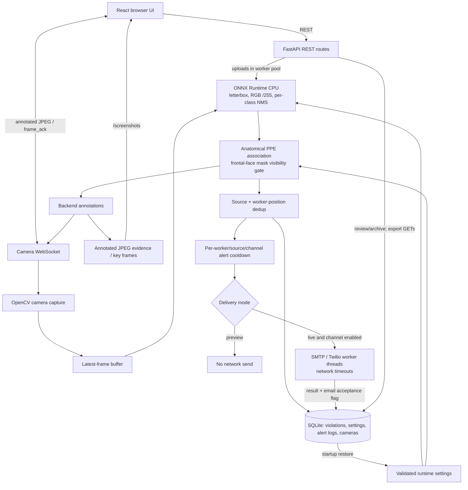

# SafeGuard AI

A construction PPE detection and incident-review project using **React + Vite**, **FastAPI**, **SQLite/SQLAlchemy**, **OpenCV**, and **ONNX Runtime**. The backend runs `backend/best.onnx` with `CPUExecutionProvider`; it does not load a `.pt` model or use the Ultralytics Python package for inference.

## Implemented behaviour

- Configured webcam/IP/RTSP cameras, one selected live feed in the Dashboard, and backend-drawn annotations. Switching cameras closes the previous socket and clears its image.
- Four model classes: `0 Face Mask`, `1 Helmet`, `2 Person`, `3 Safety Vest`. Input is 640x640, letterboxed, RGB and divided by 255; output is `1x8x8400` without embedded NMS. NMS is applied per class.
- Default required PPE: **Helmet + Safety Vest + Face Mask**. A detected mask counts as present. Without a detected mask, a mask violation requires a person at least 100x160 pixels and a centered frontal-face detection in the upper half. Otherwise the result is **mask not assessable**, not a mask violation. Helmet/vest checks continue independently.
- Image uploads show annotated results, worker/PPE states, created violation IDs and an image download. Videos report decoded/analyzed frames, worker observations and violations, with up to six downloadable annotated key frames. Full annotated video export is not implemented.
- Filtered, paginated violation history; read-only CSV/PDF exports of **all matching pages**; PDF summary/table and available evidence thumbnails.
- Acknowledge, Escalate and Archive Evidence persist timestamps/status. Archive hides records from default lists without deleting rows or screenshots.
- Validated site settings are saved in SQLite and restored into runtime configuration at startup.
- Email/WhatsApp delivery runs off the event loop. The default `ALERT_DELIVERY_MODE=preview` prevents transport connections even if saved DB alert toggles are enabled. Email previews include downloadable MIME `.eml` content and evidence attachments.
- Health checks model loading, actual execution provider and database connectivity. SMTP status is a configuration check only, never a send/login/connectivity test.

## Architecture



Detailed references: [backend](docs/backend.md), [frontend](docs/frontend.md), [database](docs/database.md), [ML/rules/alerts](docs/ml-violations-alerts.md), [API contract](docs/backend_api_contract.md).

## Clean-machine setup

Use Python 3.11/3.12 with pip and a compatible ONNX Runtime wheel, Node.js **22.12+**, npm, and Git. The frontend plugin declares Node `^20.19.0 || >=22.12.0`; old Node 18 setups are not supported by that plugin. Start in the checked-out repository root. Provide the approved `backend/best.onnx` export if it is not included in your checkout. Startup neither downloads nor trains a model.

### Windows PowerShell

```powershell
python -m venv .venv
.\.venv\Scripts\python.exe -m pip install --upgrade pip
.\.venv\Scripts\python.exe -m pip install -r backend\requirements.txt "pydantic>=2,<3"
npm install
npm --prefix frontend ci
if (!(Test-Path backend/.env)) { Copy-Item backend/.env.example backend/.env }
```

Use a dedicated data directory so a first run does not reuse a database bundled with an older checkout:

```powershell
$sgData = Join-Path $env:LOCALAPPDATA 'SafeGuard'
New-Item -ItemType Directory -Force -Path $sgData | Out-Null
$env:DATABASE_URL = 'sqlite:///' + (Join-Path $sgData 'safeguard.db').Replace('\','/')
$env:SCREENSHOT_DIR = Join-Path $sgData 'screenshots'
$env:ALERT_DELIVERY_MODE = 'preview'
.\start.bat
```

### Linux / macOS (Bash)

```bash
python3 -m venv .venv
.venv/bin/python -m pip install --upgrade pip
.venv/bin/python -m pip install -r backend/requirements.txt 'pydantic>=2,<3'
npm install
npm --prefix frontend ci
if [ ! -e backend/.env ]; then cp backend/.env.example backend/.env; fi

SG_DATA="${XDG_DATA_HOME:-$HOME/.local/share}/safeguard"
mkdir -p "$SG_DATA/screenshots"
export DATABASE_URL="sqlite:///$SG_DATA/safeguard.db"
export SCREENSHOT_DIR="$SG_DATA/screenshots"
export ALERT_DELIVERY_MODE=preview
bash ./start.sh
```

Install OS camera permissions/drivers and OpenCV runtime libraries required by your OS. Some Linux environments need their distribution's GLib/OpenGL runtime packages. Video decoding also depends on codecs available in the installed OpenCV build.

### Daily startup and shutdown

After setup, **one command** starts both services: `.\start.bat` on Windows, or `bash ./start.sh` on Linux/macOS. The launchers locate their own checkout, prefer `.venv`, then `backend/.venv`, then legacy `backend/venv`, and otherwise use Python on PATH. They check dependencies but do not install packages automatically.

Both services share one foreground terminal with labelled logs. Open **http://127.0.0.1:5173**; API/Swagger are **http://127.0.0.1:8000/api/health** and **http://127.0.0.1:8000/docs**. Press **Ctrl+C** to stop both. `concurrently --kill-others` stops the peer when either process exits. Port conflicts are errors; Vite is not allowed to silently choose another port. Startup messages are not a readiness guarantee: read errors and check health.

The launchers bind locally, pin ports 8000/5173, set the matching Vite proxy target, and default the process delivery mode to `preview`. They preserve an explicitly set process delivery mode. Re-export custom database/evidence paths in each new terminal if you use them. Otherwise the backend's default relative paths resolve to **`backend/safeguard.db`** and **`backend/screenshots/`**, because the launchers start Python from `backend/`. The separate repository-root `safeguard.db`, if present, is not that default database.

The root `npm run dev` is an older alternative with different flags: it relies on PATH Python and binds the backend on all interfaces. Use the fixed launchers for the documented local workflow.

## Configuration and saved settings

`config.py` loads `backend/.env` without overriding existing process variables. Use process variables or a private `.env` for deployment configuration; never publish credentials. The example template contains legacy `REQUIRED_PPE`/class-list and debug-receiver comments: current code and these docs are authoritative. `REQUIRED_PPE` from the environment is ignored. Defaults include all three items; subsequent site-policy changes are saved through Settings.

| Setting | Default / behaviour |
|---|---|
| `MODEL_PATH` | `best.onnx`, resolved relative to `backend/` |
| `CONFIDENCE_THRESHOLD`, `IOU_THRESHOLD` | `0.5`, `0.45`; saved confidence overrides its initial environment value |
| `STREAM_DETECTION_INTERVAL` | `3`, minimum 1; cached results between detections |
| `DATABASE_URL` | `sqlite:///./safeguard.db`; SQLite is the implemented database |
| `SCREENSHOT_DIR` | `./screenshots`; evidence remains on disk |
| `MAX_IMAGE_UPLOAD_BYTES`, `MAX_VIDEO_UPLOAD_BYTES` | 10 MiB / 100 MiB; images also limited to 25 million pixels |
| `VIOLATION_COOLDOWN_SECONDS` | 10; position-based record deduplication |
| `ALERT_DELIVERY_MODE` | `preview` or `live`; process/environment only, never overwritten by saved DB toggles |
| `ALERT_DEBUG_MODE` | `false`; if true, delivery is preview-only even when mode is `live`; no debug SMTP listener is started |
| `ALERT_NETWORK_TIMEOUT_SECONDS` | 10 per transport operation; valid range greater than 0 and at most 60 |
| `ALERT_TIMEZONE` | `Asia/Karachi`; DB times are UTC; email/WhatsApp content includes an explicit offset/zone |
| `ENABLE_EMAIL_ALERTS`, `ENABLE_WHATSAPP_ALERTS` | Initial values false; saved DB toggles take precedence at startup |
| `EMAIL_COOLDOWN_SECONDS`, `WHATSAPP_COOLDOWN_SECONDS` | Initial 30 / 60 seconds; saved values override these |
| SMTP | `SMTP_HOST`, `SMTP_PORT`, `SMTP_USER`, `SMTP_PASSWORD`, `ALERT_EMAIL_FROM`, `ALERT_EMAIL_TO` |
| WhatsApp | `TWILIO_ACCOUNT_SID`, `TWILIO_AUTH_TOKEN`, `TWILIO_WHATSAPP_FROM`, `ALERT_WHATSAPP_TO` |

The earliest settings row restores confidence, required PPE, recipients, alert toggles and cooldowns before requests are served. Invalid saved values fail startup rather than partially applying an invalid configuration. SMTP/Twilio credentials and delivery mode are not stored in that table. Merely setting `ENABLE_EMAIL_ALERTS=false` in a shell does **not** override a saved enabled toggle. Use `ALERT_DELIVERY_MODE=preview` for non-delivering tests.

Preview first in Settings or a violation's detail view. Preview GETs return content without sending or writing alert logs. **Only an operator who deliberately opts into live delivery should use the send buttons.** Live automatic alerts can also run when a saved channel toggle is enabled. The Settings test-email button makes one attempt to the saved recipient, bypasses normal cooldown, and shows the actual result. SMTP acceptance is not proof of inbox delivery; Twilio queue acceptance is not final WhatsApp delivery.

## First-use check

1. Check `/api/health` for a loaded model, actual provider and reachable database. An unconfigured SMTP server must not be described as connection-tested.
2. Add a camera, click Test, then select it in Dashboard and Start. The test endpoint checks capture opening; the live stream also detects failed reads. Camera testing may fail while another application owns the webcam.
3. Upload an image and short video; inspect worker states and download the annotation/key frames.
4. Filter Violations, export CSV/PDF, and compare the export count with all matching records, not only the displayed page. Acknowledge/Escalate, refresh, and check timestamps. Archive a record, then use **Archived evidence only** to find it.
5. Save settings and restart against the **same** database. Confirm values persist. Keep preview delivery enabled while checking alert content.

## Isolated verification

From the root, with the backend virtual environment active:

```bash
python -B -W ignore::DeprecationWarning -m unittest backend.test_detection_model backend.test_ppe_association backend.test_ppe_defaults backend.test_status backend.test_live_stream backend.test_mask_visibility backend.test_violation_workflow backend.test_uploads backend.test_saved_settings backend.test_alerts
node --test frontend/test/live_stream.test.mjs frontend/test/violation_reports.test.mjs frontend/test/uploads.test.mjs
node frontend/test/ui_status.test.cjs
```

These selected suites use synthetic inputs and disposable databases; alert tests use fake transports and block outbound sockets. Do not indiscriminately execute legacy integration scripts against an existing database. `npm --prefix frontend run build` verifies the production frontend bundle but does not deploy it.

`backend/tools/sanity_check.py --help` describes a direct real-model, 12-image check. It requires a dataset outside the repository and a **fresh output directory outside the repository**. It forces preview, disables channels, guards the database URL with in-memory SQLite, imports no API/DB/alert paths, and writes annotated comparisons plus a JSON report. The default dataset/output paths are specific to the development machine; override them on another machine. A sanity check is not a test-set evaluation.

## Limitations and evaluation status

- CPU inference is roughly 2-3 detections/second on the development machine, not a guaranteed live-video rate. One 12-image check measured about 338 ms/image for detection only. Face checks, encoding and storage add work. The stream sends newer frames with cached boxes; boxes can lag motion. Frame skipping can miss short events.
- Missing masks are assessed only with sufficiently large, plausibly frontal faces. Haar frontal-face detection is a heuristic; obscured, side/back-facing or distant faces often remain unassessable. Such workers are not counted as fully compliant when no other PPE violation exists.
- PPE association and cooldown identity use geometry/position, not persistent tracking or re-identification. Overlapping/moving workers and camera motion can cause wrong associations, duplicate records or suppression.
- Video worker counts are observations per analyzed frame, not unique workers. Full annotated video encoding and persistent upload jobs/progress percentages are not implemented.
- Final accuracy, precision/recall, per-class mAP and generalization claims are **pending leakage-free retraining and independent held-out evaluation**. Audit duplicates and split by source/video/session before retraining; report per-class results, false positives, occlusion/distance/lighting tests and real-site videos. Do not present old training metrics or the 12-image check as final evidence.
- This is not a safety-certified control system. The API currently has no authentication/role enforcement; camera credentials are stored/returned in plaintext, and a destructive legacy delete endpoint still exists. Keep it local or behind appropriate access controls. There is no operational emergency-stop or PTZ capability.
- SQLite/filesystem storage, in-memory cooldowns (reset on restart), one selected feed per Dashboard and no complete camera-stall recovery limit deployment scale. Back up the database and evidence together; follow [database guidance](docs/database.md).
