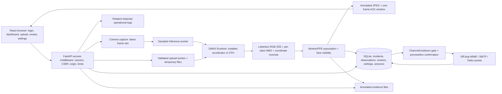

# Architecture

Live and upload routes share the model and rules. Each live viewer has independent capture/error state. One latest-frame slot drops old inputs; frame acknowledgements bound delivery. Cached detection results may lag motion. Upload processing and transports run off the event loop. Observation storage has its own per-frame denominator, independent of violation cooldowns.

Camera secrets use a stable external Fernet key. Login protects HTTP, WebSockets and evidence. Settings restore at startup; secrets and live-delivery authorization do not come from the settings table. Demo databases carry explicit metadata/banner. This is a single-machine/single-admin architecture; it does not claim distributed capture, multi-user roles, identity tracking or unlimited camera capacity.
