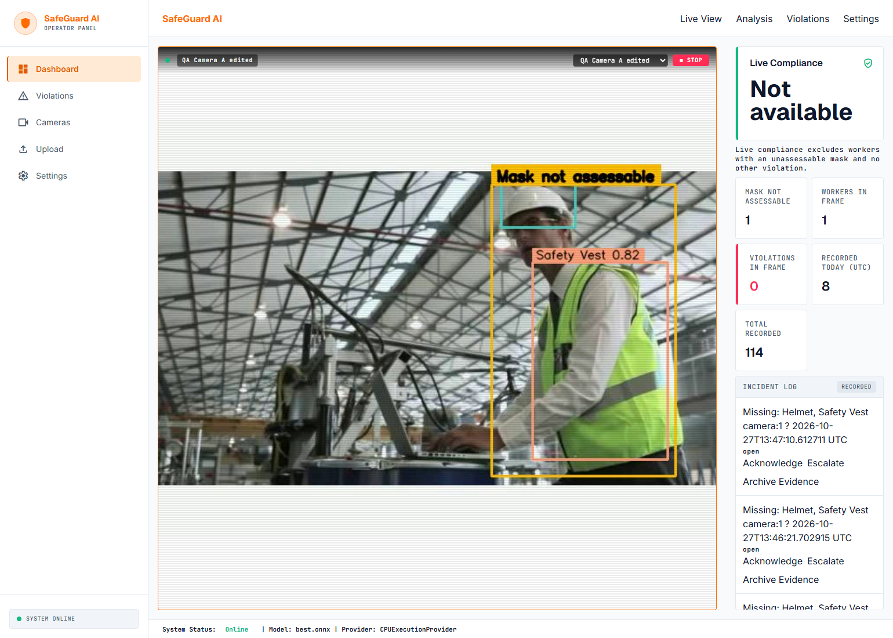
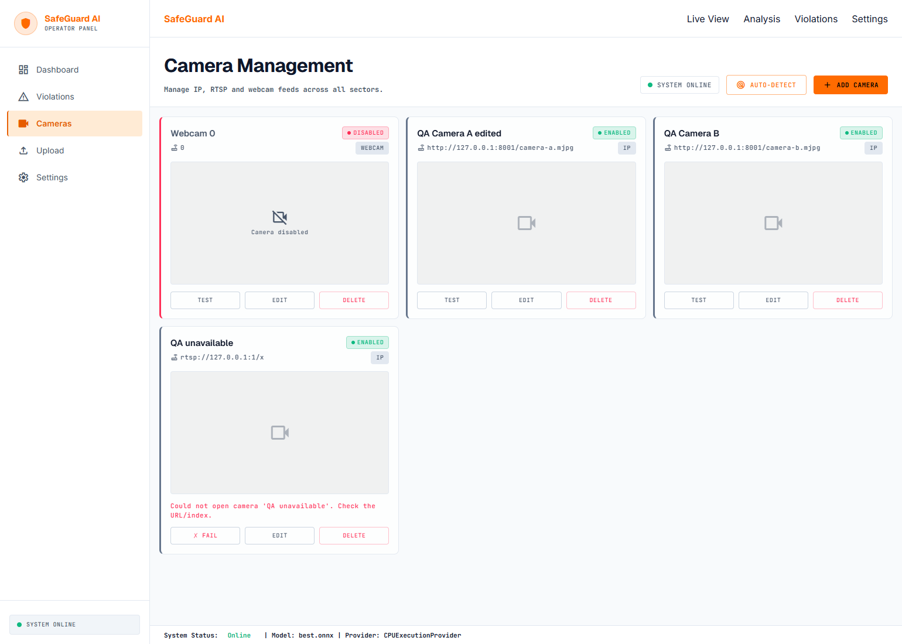
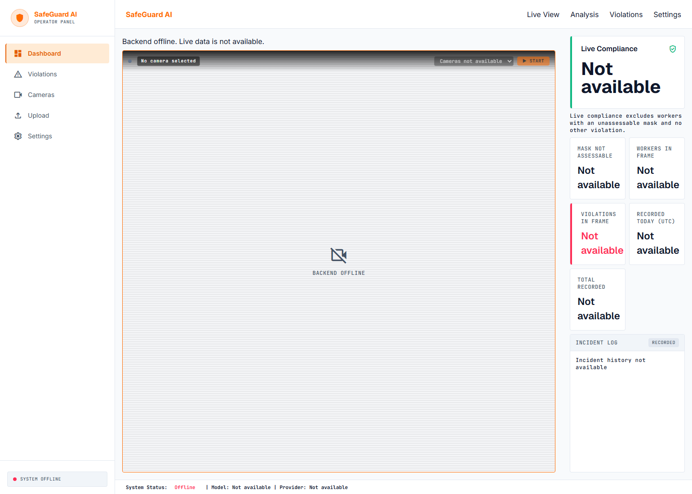
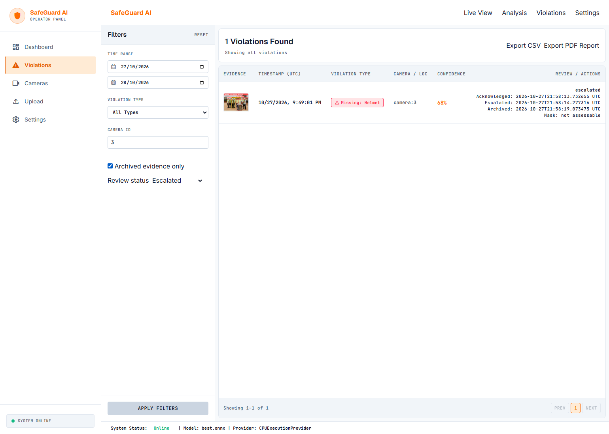
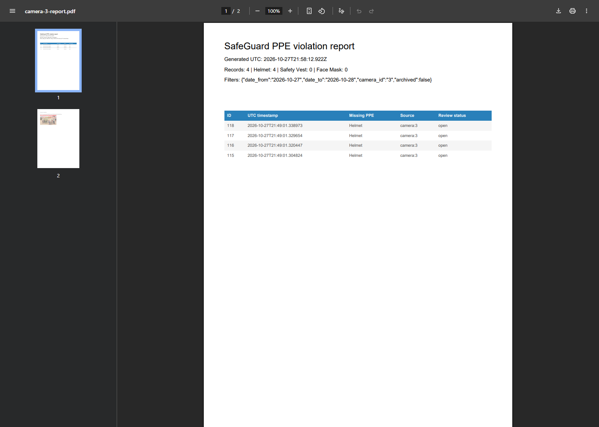
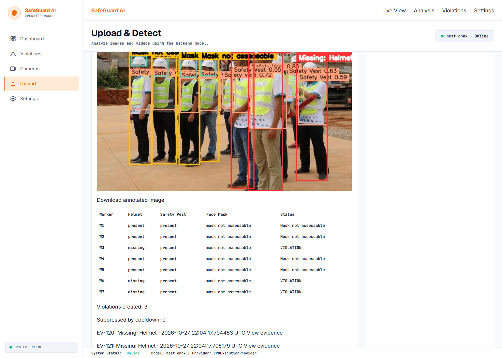
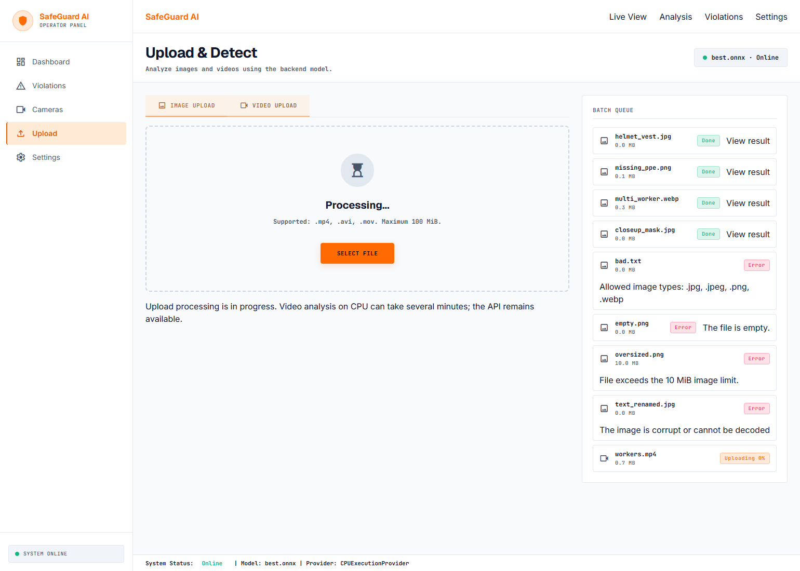
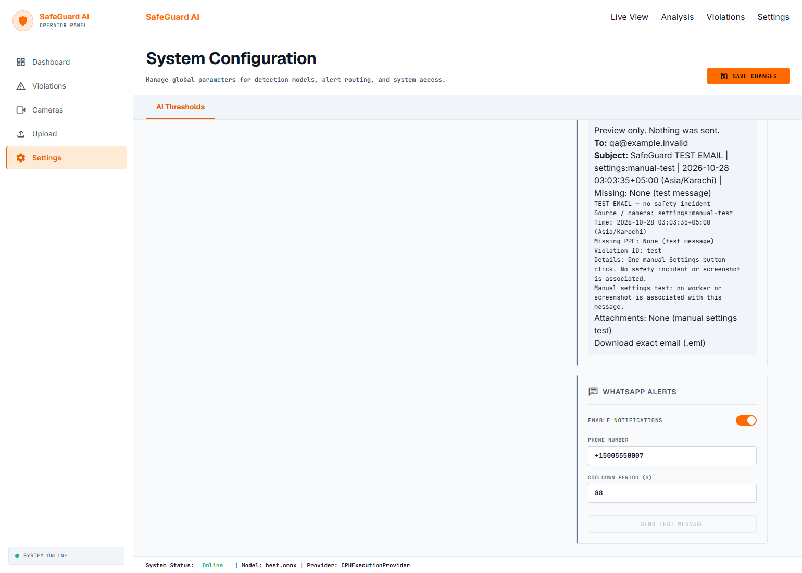

# SafeGuard user guide

Follow the [clean-machine setup](../README.md#clean-machine-setup), then run `start.bat` (Windows) or `bash start.sh` (Bash). Open http://127.0.0.1:5173. These screenshots were captured from Chrome using a disposable backup database, local video fixtures and preview-only alerts. They are QA examples, not accuracy claims or current site statistics.

## Dashboard and cameras

Check the sidebar/footer health indicator. Online requires a reachable backend, loaded model and reachable database. The footer identifies `best.onnx` and its real provider. Missing historical worker/compliance values are unavailable because a violation-only database cannot supply them.

In Cameras, Add Camera, choose webcam/IP/RTSP, provide the source URL when required, then Apply Config. Edit changes its saved configuration; Enabled controls whether Dashboard offers it. Test must decode a frame and displays the actual failure message. A saved/enabled camera is not necessarily online. Resolution/FPS controls are absent because those settings are not implemented.

In Dashboard choose a camera and Start. Selecting another camera stops the old connection and starts the selected one. Stop clears the feed. An unavailable camera shows an error. Boxes are drawn by the backend and cached between sampled detections. The live counters describe the current frame; recorded incidents come from SQLite. Incident actions update the same review status as the Violations page.

## Violations, evidence and exports

Use date, PPE type, numeric camera ID, review status and archived-only filters. Reset clears them. Pagination changes the displayed page; CSV and PDF include **every matching page**. PDF contains the summary, table and available evidence thumbnails. Exports preserve records.

Click a row for its evidence/source/details. Open full-size evidence opens the stored image. Acknowledge and Escalate save their first timestamps; acknowledgment does not downgrade escalation. Archive Evidence hides a record from default history and the incident log while preserving its row/file. Select Archived evidence only to find it again. There is no violation-delete control; the old bulk-delete API returns 405.

Preview email builds the exact subject/body/recipient/attachment and permits downloading `.eml` without sending. A violation preview includes its annotated screenshot; the manual Settings preview has no incident screenshot. Quick Share prepares an external WhatsApp composition URL; sending in that external service is a separate operator action. Twilio delivery remains blocked by preview mode.

## Image and video uploads

Select Image Upload or Video Upload. Select File or drag files into the drop zone. The displayed allowed formats and size limits come from the backend. Invalid content, including text renamed as an image, is rejected. A queue item retains its result/error; View result reopens it.

Images show the annotated result, worker/PPE table, newly created violation IDs and an annotated-image download. `mask not assessable` means the required mask could not be assessed safely; it does not mean the worker is fully compliant. The model can still miss visible PPE: review the actual image before acting.

Videos show a busy state while processing, then decoded/analyzed frame counts, worker observations, violations, and up to six downloadable annotated key frames. Observations are not unique workers. A complete annotated video download is not available. You can open Dashboard in another tab during processing; the CPU is still shared.

## Settings and alerts

Change confidence, PPE requirements, channel toggles, recipients and cooldowns, then Save Changes. Values are validated and restored from the same database after restart. Defaults require Helmet, Safety Vest and Face Mask. A missing mask is assessed only on sufficiently large workers with a plausibly visible frontal face; other workers remain mask not assessable. Helmet/vest rules operate independently.

Keep `ALERT_DELIVERY_MODE=preview` during inspection. The process-level mode blocks transport calls even when saved alert toggles are enabled. Send test email is disabled in preview mode with an explanation. SMTP configured reports configuration completeness only. See [the live-delivery procedure](ml-violations-alerts.md#deliberately-enabling-live-delivery) before intentionally sending anything. Final QA did not send email or WhatsApp.
