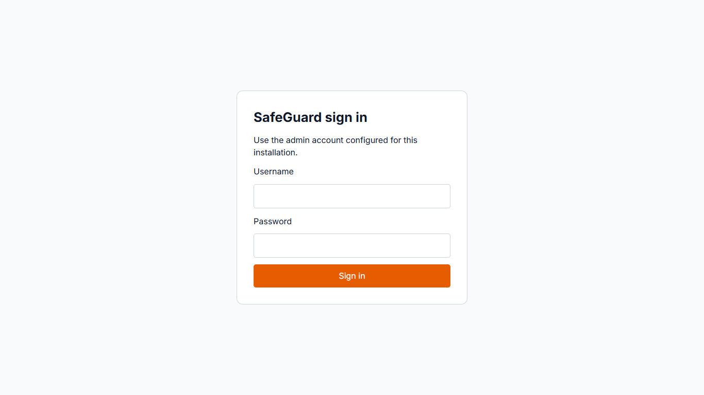
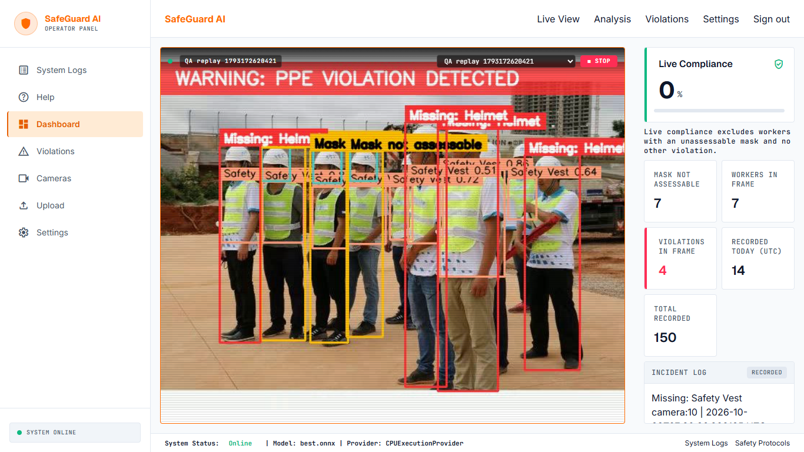
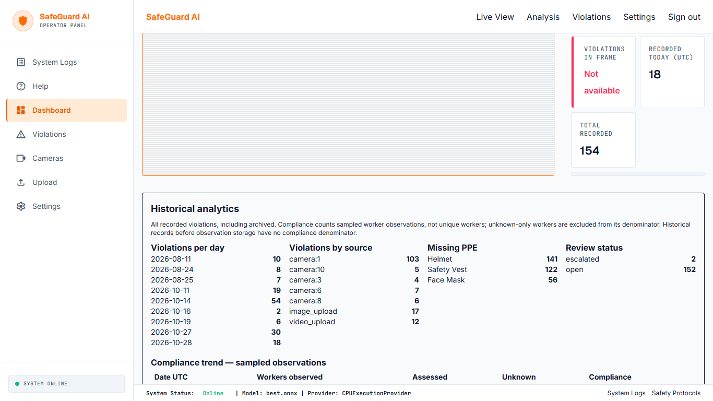
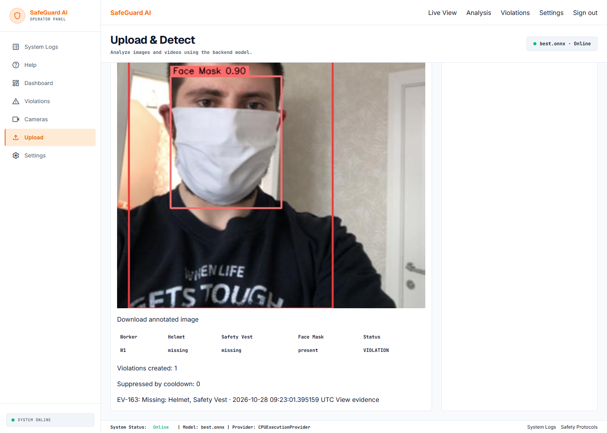
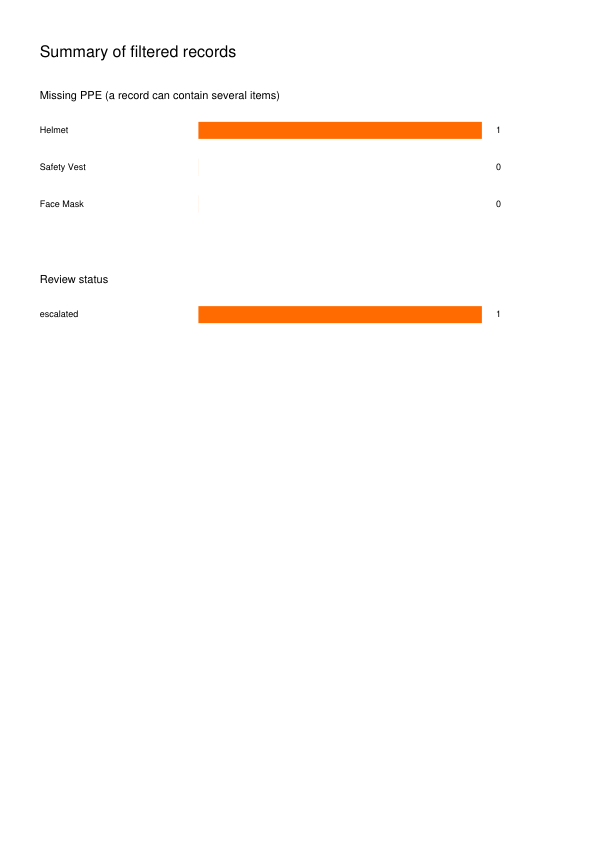
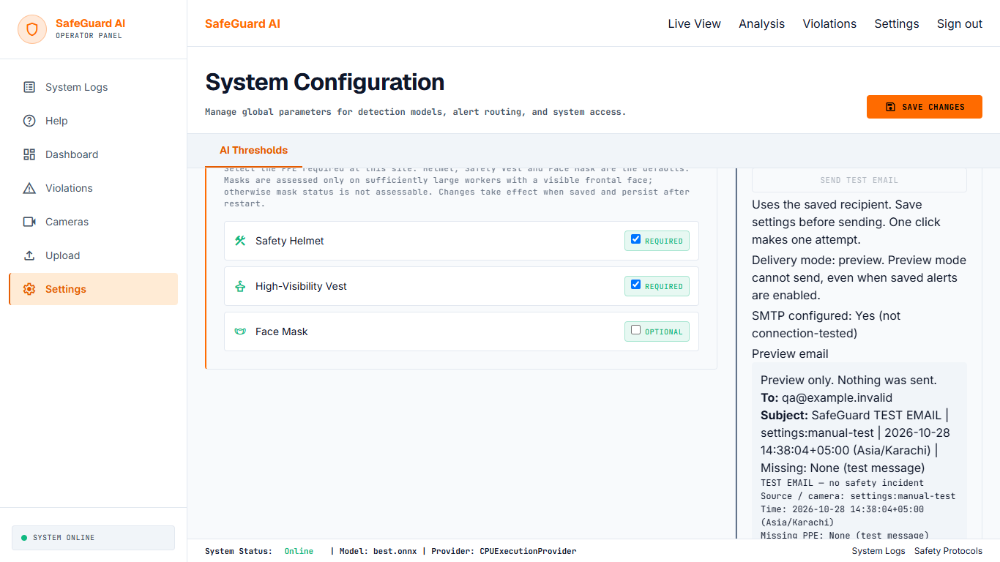

# SafeGuard user guide

## Start and sign in

Follow [README](../README.md) to install dependencies and provide the initial admin password and stable camera-encryption key. Start both servers with `start.bat` (Windows) or `bash start.sh` after setup. Open `http://127.0.0.1:5173`. Sign in before APIs, live views or evidence can be accessed. Sign out revokes the session.

## Dashboard and cameras

Online means the backend is reachable, the model loads and SQLite responds. Offline clears live data; degraded identifies a model/database issue. Footer model/provider values come from backend health. No camera frames means no current worker/compliance numbers.

On Cameras, add a numeric webcam or HTTP(S)/RTSP(S) source, optionally enter credentials, then test it. The real returned message determines success. Blank credential edits retain saved secrets. Selecting a camera on Dashboard starts/switches it; Stop closes it. Failure clears stale images and shows reconnect state, then a terminal error after the retry budget. Physical camera behavior still needs local testing.

Historical analytics count recorded incidents and sampled worker observations. Unknown-only workers do not enter the compliance denominator. Repeated frames are not unique people.

## Uploads

Choose Image Upload or Video Upload, then Select File or drag/drop. Observe allowed types/limits. Wait for processing; do not treat a busy video as a frozen page. Images show annotation, worker/PPE states and records actually created. Videos show analyzed-frame/observation summaries and downloadable annotated key frames, not an exported annotated video. A mask may be present, missing, or not assessable. Cooldown can suppress repeated records without suppressing detected-worker results.

## Review and export

Set date, PPE, camera, review and archived filters; use pagination. Open an incident/evidence before deciding whether it is valid. Acknowledge and Escalate persist timestamps; Archive hides it from the default list and retains data/files. Archived evidence only shows archived records. There is no violation-delete control.

CSV/PDF export all records matching the filters. PDF includes date range, title/summary charts, table and evidence thumbnails. Preview email opens the exact MIME content and attachment metadata without sending. Review the screenshot and source/time/missing PPE before any delivery decision.

## Settings, preview and logs

Save required PPE, confidence, recipients, cooldowns and detection frame interval. Defaults require Helmet, Safety Vest and Face Mask. Changes survive restart; restart an existing stream after changing its interval. Missing-mask checks apply only where the face heuristic can assess them; unknown is not compliance.

Preview mode blocks real email/WhatsApp regardless of saved toggles. Test-send and live-confirmation buttons explain restrictions. Actual live delivery needs deployment environment permission plus typed confirmation for that process; restart clears confirmation. Read [alert operation](ml-violations-alerts.md) before enabling it. This QA never sent real messages.

System Logs shows real recent redacted UTC log lines; Refresh reloads them. Help/Safety Protocols explains review, visibility, delivery and camera troubleshooting. Keep [limitations](limitations.md) in mind when presenting or using the system.
